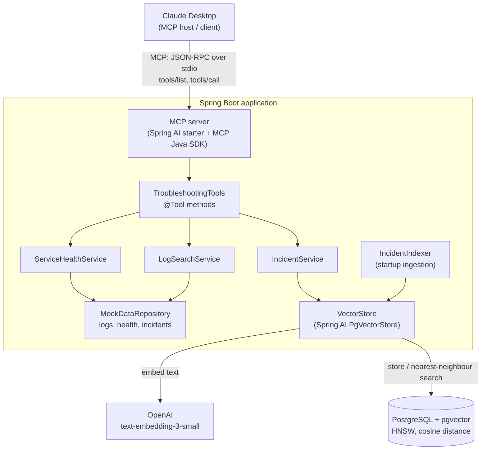

# AI-Powered Production Troubleshooting Assistant

A Java Gen AI application that lets an AI assistant investigate production issues in natural language.
It exposes **log search, service health checks and similar-incident lookup as MCP tools**, so an MCP
client such as Claude Desktop can gather evidence and suggest a likely root cause. Similar incidents
are found with **RAG**: past incidents are embedded and searched by meaning in **PostgreSQL + pgvector**.

**Stack:** Java 21 · Spring Boot 4 · Spring AI 2.0 · Model Context Protocol (MCP) · OpenAI embeddings ·
PostgreSQL 16 + pgvector · Docker · JUnit 5 / AssertJ / Mockito

> Demo video: _coming soon_

---

## What it does

Ask Claude Desktop: *"payment-service is failing. Investigate and tell me the likely root cause, with evidence."*

The model decides which tools to call, and in what order. A typical investigation:

1. `checkServiceHealth("payment-service")` → status **DOWN**, db **DOWN**, DB pool 10/10 active, 22 waiting
2. `searchLogs("payment-service", level="ERROR")` → repeated `Connection is not available, request timed out after 30000ms`; a WARN search adds a connection-leak warning on the `refund-batch-1` thread
3. `findSimilarIncidents("payments failing, DB connection pool exhausted")` → **INC-1042**: a refund batch job held DB connections; fixed with chunked commits and a separate pool

It then answers with the likely root cause, citing log lines and the past incident.

The data simulates a three-service e-commerce system (payment, order, inventory) with a cascading
failure: a refund batch job exhausts payment-service's connection pool, order-service times out and
opens its circuit breaker, and inventory reservations pile up.

## Architecture



**Design idea:** one set of business services with thin entry layers on top. MCP was added without
changing the services, and RAG replaced one service's internals without changing the MCP layer.

## The MCP tools

| Tool | Purpose | Notes |
|---|---|---|
| `listServices` | Names of services that can be investigated | Lets the model avoid guessing names |
| `checkServiceHealth(service)` | Status, component health, key metrics | Description tells the model to start here |
| `searchLogs(service, level?, keyword?, limit?)` | Newest-first log search | Bounded: default 20, max 50 entries |
| `findSimilarIncidents(query, limit?)` | Past incidents by meaning, with root cause and fix | RAG over pgvector; returns similarity scores |

Unknown service names return an error listing the valid names, so the model can correct itself.

## RAG: how similar incidents are found

**Indexing (at startup, once):** each incident's title, service, symptoms, root cause and tags are
embedded with OpenAI `text-embedding-3-small` (1,536 dimensions) and stored in pgvector with metadata.
Ingestion is idempotent: stable UUIDs per incident, and embedding is skipped if already indexed.

**Retrieval (per tool call):** the query is embedded, pgvector returns the nearest incidents by cosine
distance using an HNSW index, results below a similarity threshold are dropped, and the full incident
records go back to the model.

### Results: keyword vs semantic search

| Query | Keyword baseline | Semantic search |
|---|---|---|
| "all db connections busy, payments failing" | **no match** | **INC-1042, 0.585** (correct) |
| "services cannot resolve hostnames, UnknownHostException everywhere" | n/a | INC-1140, 0.500 (correct) |
| "kafka consumers falling behind" | n/a | INC-1084 0.553, INC-1158 0.481 (correct) |
| "pods keep restarting with OutOfMemoryError" | n/a | INC-1063, 0.527 (correct) |

**Threshold tuning:** correct matches scored about 0.48–0.59 and unrelated ones about 0.30–0.38, so the
threshold was raised from 0.3 to 0.4 to keep weak, misleading evidence away from the model.

## Key design decisions

- **Separate AI-facing layer** (`TroubleshootingTools`) from business services: clean layering, and the
  same tools can serve other entry points.
- **Tools tested without AI first:** separates logic bugs from integration bugs.
- **Bounded outputs and recoverable errors:** controls token cost and lets the model self-correct.
- **Clean stdout in the stdio profile:** no banner or console logging, since stdout carries only MCP
  messages; logs go to a file.
- **Tool-call logging:** tool, arguments, result count and duration for every call.
- **pgvector over a dedicated vector database:** reuses PostgreSQL, keeps SQL and vectors together, and
  is sufficient at this scale.
- **Embed problem-describing fields only:** queries describe problems, so the resolution isn't embedded.
- **Secrets from environment variables:** the API key never appears in code or Git.
- **Data access behind a repository:** the mock data can be replaced by real log, metrics and incident
  systems by changing one class.

## Run it locally

**Prerequisites:** JDK 21, Docker Desktop, an OpenAI API key, Claude Desktop.

```bash
# 1. API key (Windows: setx OPENAI_API_KEY "sk-..." then restart your IDE / Claude Desktop)
export OPENAI_API_KEY=sk-...

# 2. PostgreSQL + pgvector
docker compose up -d

# 3. Build (runs the tests; the semantic-search test runs only when OPENAI_API_KEY is set)
mvn clean package
```

**Register the MCP server in Claude Desktop** (Settings → Developer → Edit Config):

```json
{
  "mcpServers": {
    "troubleshooting-assistant": {
      "command": "java",
      "args": ["-jar", "/path/to/target/ai-troubleshooting-assistant-0.0.1-SNAPSHOT.jar",
               "--spring.profiles.active=mcp"]
    }
  }
}
```

Fully restart Claude Desktop. The four tools appear under `troubleshooting-assistant`.
In the `mcp` profile, application logs (including every tool call) are written to
`<temp dir>/ai-troubleshooting-mcp.log`.

## Project structure

```
src/main/java/com/troubleshooting/assistant/
├── model/        records: LogEntry, ServiceHealth, Incident, IncidentMatch
├── repository/   MockDataRepository: loads simulated logs, health, incidents
├── tools/        business services + TroubleshootingTools (@Tool layer)
├── rag/          IncidentIndexer: embeds incidents into pgvector at startup
└── config/       ToolConfig: registers the @Tool methods
src/main/resources/
├── application.yml       datasource, OpenAI, pgvector, thresholds
├── application-mcp.yml   stdio MCP profile used by Claude Desktop
└── data/                 simulated logs, service health, 20 historical incidents
```

## Production design (not implemented here)

- **Transport and auth:** Streamable HTTP instead of stdio, TLS at the gateway, and an OAuth 2.1
  resource server (Spring Security) validating JWTs, with per-tool scopes such as `logs:read`.
- **Least privilege:** read-only tools; a narrowly scoped service account or on-behalf-of tokens for
  downstream log and metrics systems.
- **Data protection:** redact PII and secrets from tool output before it reaches the LLM; an enterprise
  LLM agreement or a self-hosted model for regulated data.
- **Prompt injection:** treat log and incident text as data, keep tools read-only, keep human approval.
- **Operations:** rate limits, timeouts, token budgets, audit logging of every tool call, and secrets
  in a vault.

## Next steps

- Own agent endpoint (`/ask`) using Spring AI `ChatClient` tool calling with structured output
- Evaluation set of investigation questions, scored before and after changes
- Self-hosted embedding model (ONNX) to keep indexing fully on-premise
- Real backends: Elasticsearch/Loki for logs, Prometheus for metrics, an incident tracker
- Streamable HTTP transport with OAuth for shared use
